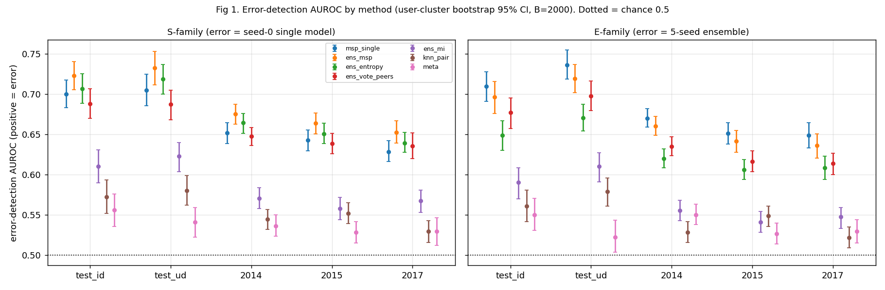
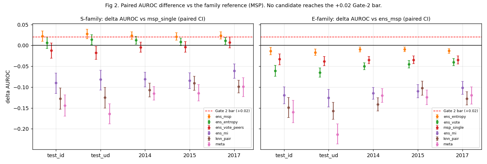
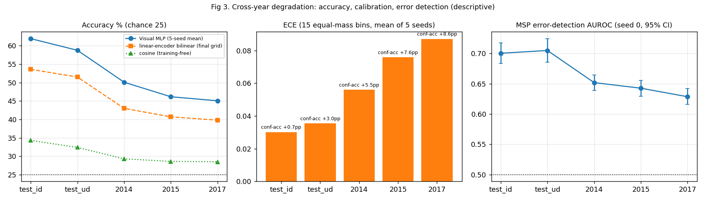
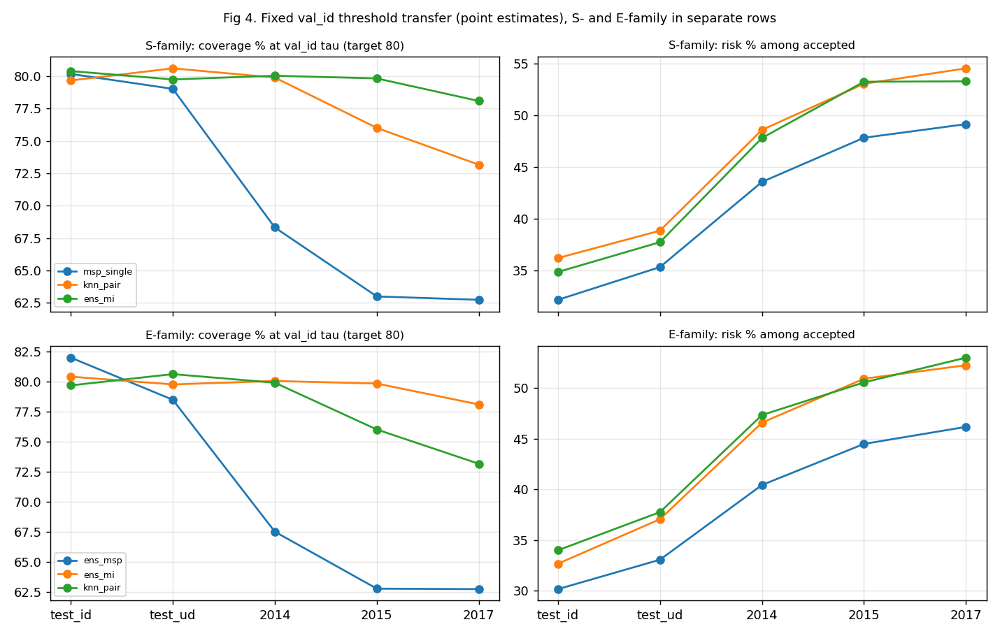

# OutfitMatch 研究線最終報告：Task B 跨年份退化（Experiment 1）與 temporal shift 下的 reliability / error detection（Experiment 2）

- 報告日期：2026-10-12（UTC+8）。所有實驗都是同一天內完成（Phase 1/2：17:36–18:55；Experiment 2：19:05–20:06）。
- 讀者：學生本人（繁體中文），以及沒有 repo 權限的 ChatGPT。技術名詞保留英文。
- 資料來源原則：**只使用已完成的結果**。本報告沒有訓練任何模型、沒有新增任何實驗、沒有修改任何既有檔案；唯一的「重算」是從已存檔的 `scores.npz` / `main_bootstrap.pkl` / `exp1_instance_table_taskB.npz` 以獨立的 numpy 程式碼驗證關鍵數字（輸出在 `final_report_assets/verification_recompute.txt`）。
- 檔案路徑一律相對於 `/home/chi/outfitmatch-research/`（撰寫本報告時，磁碟上的實際位置；原指派寫的 `/home/chi/code/outfitmatch-research/` 當時並不存在，見 §11.5）。

---

## 0. Abstract（English）與一句話結論

**Abstract.** We study whether unreliable outfit-matching predictions can be detected under natural temporal distribution shift, using SHIFT15M (IQON outfits, frozen VGG16 fc6 features), a leakage-audited category-aligned 4-way fill-in-the-blank task ("Task B"), and five frozen visual-MLP seeds trained on 2013 outfits. Experiment 1 shows a large, descriptive cross-year degradation: accuracy falls from 61.9% (same-year test_id) to 50.1 / 46.2 / 45.1% on 2014 / 2015 / 2017, expected calibration error (ECE) rises from 0.030 to 0.056 / 0.076 / 0.087, and the model's maximum-softmax-probability (MSP) loses error-detection AUROC (≈0.70 → 0.63–0.65). A pre-registered Gate 1 passes (via an OR rule; the 2014 ECE criterion alone fails its threshold). Experiment 2 compares MSP with a kNN-on-pair-embedding score, 5-seed ensemble scores (mean-MSP, entropy, mutual information/disagreement) and a metadata-only control. Pre-registered Gate 2 is **not** passed (0/3 years for both kNN and ensemble-MI; both are 0.06–0.11 AUROC *worse* than MSP, paired CIs entirely below zero). The only score better than MSP is the ensemble-mean MSP (+0.02 AUROC, risk@80% difference not significant, 5.1× inference cost). We therefore report a bounded negative result. Claims are descriptive: we do not claim a causal mechanism from temporal shift to calibration degradation, we do not claim the model can identify its own errors, and we do not claim methodological novelty.

> **核心結論（必須原文保留）：我們觀察到跨年份可靠性退化，但尚未找到值得採用的新可靠性方法。**
> （We observed cross-year reliability degradation but have not found a new reliability method worth adopting.）

三個一句話版本：
1. 現象：同一個凍結模型在較晚年份的 accuracy、calibration、MSP 偵錯能力都變差（descriptive，非因果）。
2. 方法：kNN-pair 與 ensemble-MI 都明顯輸給最簡單的 MSP；唯一小幅贏過 MSP 的是 ensemble-mean-MSP，代價是 5 倍推論成本。
3. 決策：研究線以「有界的 negative result」收尾（No-go 於再開發新方法）；產品線只帶走工具與保守的信心顯示建議（§10）。

---

## 目錄

1. 研究問題與範圍
2. SHIFT15M 資料集與 splits
3. Task B 設計與 evaluation-loophole 分析
4. 模型與 baselines（含 "descriptive baseline-relative degradation" 的措辭）
5. 跨年份 accuracy / calibration / error detection（含 CI）
6. MSP vs kNN vs ensemble（逐年）
7. Gate 1 與 Gate 2
8. 限制（Limitations）
9. 運算成本
10. 最終 Go / No-Go 與對產品的帶入
11. 可重現性附錄
12. 原始 Phase 2 要求中尚未完成或僅部分完成的項目
13. 文件間數字差異與稽核發現（Discrepancies）
14. 圖表索引

---

## 1. 研究問題與範圍

**主問題**：Can we detect unreliable outfit-matching predictions under temporal distribution shift?
白話：模型在「訓練年份以外的年份」做穿搭配對時，我們能不能在**不改模型**的前提下，找出「這題它大概會答錯」的題目？

**這份研究不是什麼**
- **不是**要提高 FITB accuracy。模型是 baseline 等級的 Visual MLP，目的不是 SOTA。
- **不是**要訓練新的 compatibility model、新 loss、或對 shifted-year 做 domain adaptation。
- **不是**因果研究：我們不主張「temporal shift → calibration 退化」的機制，只描述「同一個凍結模型在不同年份的量測值」。

**範圍界線（來自 `EXPERIMENT1_SPEC.md`、`EXPERIMENT2_PREREG.md`）**
- 資料：SHIFT15M metadata + 凍結的 VGG16 fc6 features（無原始圖片）。CC BY-NC 4.0，衍生資料只留本機。
- 模型：Phase 2 的 5 個 seed 的 visual-only MLP（`runs/phase2/visual_seed0..4`）**完全凍結**；Experiment 2 不重訓。唯一重新訓練的是 Experiment 2 之後補做的 linear baseline（§4.4），它**不**被任何 reliability 結果使用。
- 不使用 shifted-year 標籤去調任何 k、threshold、normalization 或超參數（threshold 與 k 只用 `val_id`）。
- Task A（official-style set-to-set matching）僅作參考與 shortcut 示範，未訓練。
- **與產品線的關係**：這條研究線與 OutfitMatch V2 的 DBMS / Neo4j 產品線**互相獨立**。研究結論只透過 §10.3 的少數項目影響產品；SHIFT15M 的模型權重、特徵、資料都不是產品資產。

---

## 2. SHIFT15M 資料集與 splits

### 2.1 資料集概況（`results/step0_analysis.txt`）

| 項目 | 數值 |
|---|---|
| outfits | 2,555,147 |
| item slots / unique items | 15,218,721 / 2,335,598 |
| unique users | 193,574 |
| publish_date 範圍 | 2010-03-03 – 2020-04-06 |
| 特徵 | VGG16 fc6 4096-d（官方）；本專案以 fp16 全數抽出：2,335,598 × 4096，驗證 0 bad / 0 non-finite / 0 overflow（`results/exp1_extraction_verify.txt`） |
| category_id1 | 7 類（10–16） |
| 授權 | CC BY-NC 4.0（資料）；MIT（官方軟體）。使用者須承諾不由 feature 重建圖片、不還原匿名資訊（`docs/DATASHEET.md`） |

官方 filter（≥4 種不同 category_id1 且 like_num ≥ 50）後各年份 eligible outfits：2013：42,531（6,418 users）；2014：98,296（7,078）；2015：153,617（4,515）；2016：81,302（1,332）；2017：38,518（543）。**年份越晚，user 越少、每位 user 貢獻越多**（2017 的 top-10 users 佔 32.4%）——這是後面 effective users 很小的來源。

### 2.2 本專案的 split（S1，Task B；`EXPERIMENT1_SPEC.md` §2.1、`results/exp1_manifest_report.txt`）

訓練年份 2013。測試年份 **2014 / 2015 / 2017** 為本研究的 shifted years（2016 只出現在尚未執行的 tr2014 replication manifest）。

| role | 規則 | #instances | #users | effective users（Kish） | 該 set 內 user 曾在 train 出現 | positive item_id 曾在 train | negative item_id 曾在 train |
|---|---|---|---|---|---|---|---|
| train | 2013 pool，排除 held-out users H，shuffle 後前 30,816 outfits（online 產生 instance） | 30,816 outfits | 5,137 | — | — | — | — |
| val_id | 同一 shuffle 的下 3,851 個（model selection、k、threshold **只用這裡**） | 3,851 | 1,380 | 319 | 91.0% | 70.8% | 70.2% |
| test_id | 再下 3,851 個（只剩 3,172） | 3,172 | 1,277 | 344 | 90.3% | 71.9% | 71.8% |
| test_ud | H users（md5(user) mod 10 = 0）的 outfits，train 中 0 overlap，隨機 3,851 | 3,851 | 593 | **53** | 0.0% | 72.8% | 71.9% |
| test_2014 | 該年 pool 隨機 7,702 | 7,702 | 1,937 | 453 | 21.6% | 12.7% | 13.8% |
| test_2015 | 同上 | 7,702 | 1,361 | 352 | 4.9% | 1.3% | 1.1% |
| test_2017 | 同上 | 7,702 | 373 | **53** | 5.7% | 0.4% | 0.2% |

（user 與 effective users 的數字我另以 `exp1_instance_table_taskB.npz` 獨立重算，完全一致；見 `final_report_assets/verification_recompute.txt` 與 `set_level_summary.csv`。）

重點：
- **test_id** = 同年份、user 多半見過；**test_ud** = 同年份、user 完全沒見過。兩者相差 3.1 pp accuracy（61.9 vs 58.8），代表「reference 選擇」本身就會影響 Δ。
- **test_ud 與 test_2017 的 effective users 都只有約 53**（top-10 users 佔 35.7% / 33.6% 的 instances）。7,702 題不等於 7,702 個獨立樣本。
- item 的「seen」比例從 ID 的約 71% 掉到 2014 的 12.7%、2015 的 1.3%、2017 的 0.4%：**item turnover 與年份高度糾纏**（見 §8）。
- 每個 instance 為一題 FITB：mask 1 個 item（positive），query = 剩餘 items（≥3），4 個候選（1 正 + 3 負）。

### 2.3 Manifests 與 hashes

- 位置：`step0/manifests/`；`MANIFEST_SHA256.txt` 記錄所有檔案 sha256。**我重新執行 `sha256sum -c`：25 個檔案全部 OK。**
- 組合 hash（寫進每個 run 的 `env.json`）：`manifest_sha256 = 8f39f68655be40dbac5707262907b3ae313a8eb3162309ff10ca2335ce9588f0`。
- 本報告用到的 manifest（完整 sha256；由 `sha256sum` 直接輸出，與 `MANIFEST_SHA256.txt` 逐行相同）：

```
1d41d8b2f2d1f89d6ec91f221d2638d19f8a04e4293aeb7016fe9aef887f2729  S1_tr2013_outfits.jsonl.gz
a05e4e7c20ce2f7454fe4fc269edb7bd606e1d10d1f4b1624be568a756db0013  S1_tr2013_taskB_val_id.jsonl.gz
6ac6bbaea421ef2f369f725dd16bc2473eca74ee3dcb9de56f06f40788be5cab  S1_tr2013_taskB_test_id.jsonl.gz
9ca41be27468161e3af1e87f2afba2a5c19183791b988739c94df1874e2dc100  S1_tr2013_taskB_test_ud.jsonl.gz
3a538725faf6895120c9fe51bfbd65669a684671f9456555188e28c772b46064  S1_tr2013_taskB_test_2014.jsonl.gz
3d0effc51dae223b3602fd36ff439d2b563b081b5e920dc2faa37f833972d34a  S1_tr2013_taskB_test_2015.jsonl.gz
167b345d68dd91626c8f49f3c6c3321cb0c6c774b17e6ac3487a96c5cfbd69a1  S1_tr2013_taskB_test_2017.jsonl.gz
eecf61f79b926fb627ed94ee3f4b4af7a046eb243f2f264fad148cef1ced14e9  required_items_v1.txt
```

- 去重：Task B pool 對 exact item-set duplicates 去重（丟掉 133 個 outfits；去重前 17,952 個 outfits＝0.70% 的 item-set 出現在別的 outfit）。
- Seeds：`PROJECT_SEED=20261012`、`OFFICIAL_SEED=0`，每個子 seed = md5(purpose, version, ids)；重建 manifest 會得到相同 hash（spec 稱已驗證）。
- Required items：391,422 個（S1-2013 206,366；S0 207,294；S1-2014 246,555，取聯集）；finalize 後 missing_required = 0。
- tr2014 replication manifest（train 2014；test 2015/2016/2017）已凍結但**未評估**（§8、§12）。

---

## 3. Task B（fill-in-the-blank）設計與 evaluation-loophole 分析

### 3.1 為什麼不直接用官方 set-to-set（Task A）

官方風格的 set-FITB 協議在 metadata 層級就有大量 shortcut（`results/exp1_manifest_report.txt` C 節、`exp1_check3_gate0_cosine.txt`）：

| Task A（4 候選，chance 25%） | 2013 | 2014 | 2015 | 2017 |
|---|---|---|---|---|
| category-complement（只看 category，不看影像） | 59.9 | 64.4 | 63.5 | 66.4 |
| size + category | 70.4 | 72.9 | 73.0 | 75.6 |
| 最高 cosine 者勝（centred） | 18.5 | 16.3 | 16.2 | 16.2（**低於 chance**） |

只靠 metadata 就能達 60–76%，而 cosine 反而低於 chance（category 結構主導）。因此 **Task A 只作為與官方 benchmark 的連結和 shortcut 示範**，主證據用 Task B。Task A 在本專案**沒有訓練**。

### 3.2 Task B 的設計（`EXPERIMENT1_SPEC.md` §1）

- 每個 eval outfit 一題；mask 一個 item；query = 其餘 items（≥3）。
- **Negatives**：與 positive **同 `category_id1`**；以 slot-weighted 方式抽樣（與 positive 的邊際分布相同）；**只從同一個 eval set（同年份、同 role）的 outfits 抽**；不得來自同一 user；不得是 query outfit 裡的任何 item；3 個 distinct item_id；絕不用模型分數挑選；候選位置以固定 seed 洗牌，label 與 instance_id（hash）存檔。
- 為什麼 negatives 取自同一 eval set：若取自 train outfits，negative 會是「見過的 item」→ 產生記憶捷徑。
- **明確不主張**「shortcut-free」；而是把 shortcut 逐一量測（下表）。negatives 也可能是真的相容（false negative），所以 accuracy 上限 < 100%。
- 訓練時用相同規則 online 從 train outfits 產生 instance（有 seed）。驗證／測試是凍結檔。

### 3.3 已實際跑過的 loophole / shortcut 檢查與結果

| 檢查 | 做法 | 結果（來源） | 解讀 |
|---|---|---|---|
| **candidate-only**（沒有 query） | 同 config 訓練 `cand_only` 變體 | val_id acc **25.03%**（`exp1_phase1_log.txt` §3） | 只看候選本身無法預測正確答案 |
| **query shuffle**（context 換成別題的 context） | 在已選模型上，val_id | **24.69%**（chance 25.0） | 模型確實依賴「這個 query 與候選的關係」 |
| **query removed**（context mask 全 0） | 同上 | 25.60% | 同上 |
| **random-label 訓練對照** | 標籤隨機，訓練 4 epochs | val_id acc 每 epoch 23.68 / 25.53 / 25.89 / 25.81 | 管線不會從隨機標籤「學到」東西（只跑 4 epochs，屬 sanity check，非完整統計檢定） |
| **label position bias** | 標籤位置直方圖 | 各位置 24–26%（`exp1_manifest_report.txt`）；模型預測位置 24.5–26.3%；各位置 acc 58.3–61.2 | 無明顯位置捷徑 |
| **metadata-only baselines**（Task B，chance 25） | cat1-only / cat2 prior / train popularity / price-near-context | cat1-only 25.0（by construction）；cat2 prior 24.3–25.6；popularity 24.2–25.1；**price-near-context 27.4–30.1**（test_id 30.1 [28.5, 31.7]） | 大部分 metadata 接近 chance；**價格相近度是殘留的、略高於 chance 的 shortcut** |
| **co-occurrence（train 中 pair 共現）** | id-level 共現次數 baseline；positive 與 query item 是否在 train outfit 共現 | ID sets：positive 共現 6.0–6.8%、negative 0.7–0.8%；`decidable`（有共現訊號且無負例共現）5.5–6.5%；cooc baseline acc **29.4%**（test_id）、28.9%（test_ud）；shifted years **25.0–25.1%**（`exp1_check4_followup.txt`） | ID sets 有一條 memorisation 通道，shift 後消失。MLP 在 `decidable` 子集 77.2% vs 非 decidable 60.9%（test_id）。這是 ID→shifted 掉幅的一部分來源之一，**不能量化成可加的成分**（§4.5） |
| **partial-overlap outfit**（與某 train outfit ≥50% 相同 id） | near-dup audit | ID sets 約 70–80 題（~2%）；2014 僅 7 題；2015 1 題；2017 0 題 | 已在子群表單獨列出 |
| **seen / unseen items** | 以 `item_id` 與「visual twin」分層 | positive 在 train 見過：ID ~71–73%、2014 12.7%、2015 1.3%、2017 0.4%；negative 同比例（70.2 vs 70.8 等，因 negatives 取自同 eval set） | seen 狀態**不洩漏標籤**（正負比例匹配），但與年份高度共變 |
| **visual twin**（不同 item_id、視覺幾乎相同） | centred cosine ≥ 0.999 | 取樣的 train items 有 **9.4%** 有 twin；94% 同 category_id2、90% 同價格 | 「item_id 見過」低估了視覺熟悉度；分層分析改用 `visually_seen = id_seen OR twin`（Amendment A1） |
| **near-duplicate（train vs eval）** | 視覺相似度審計 | 在 τ=0.95，P(positive 有 near-dup) 14.9% vs P(negative) 14.6%（val_id），其他 set 類似；outfit-level 洩漏（nd≥0.95 且≥50% items）≤0.03% | 無系統性 near-dup 洩漏；少量 flagged instances 已在 CLEAN 子集排除 |
| **user leakage** | user 分層 | test_ud 與 train user 0 overlap（assert）；ID sets 約 90% user 在 train；2014/2015/2017 為 21.6 / 4.9 / 5.7% | user 見過與否對 accuracy 影響很小（2015 user-seen 44.3 vs unseen 46.2，CI 寬）；已作 user-cluster bootstrap 與 user-cap |
| **exact item-set duplicates** | train vs 任一 eval set | 0（assert） | — |
| **negatives sampling 問題** | 設計說明 + 殘留 | 同 cat1（移除 category cue）、同 eval set（移除 seen cue）、非同 user；但仍可能含 false negatives、且 2017 的 negatives 只來自 373 位 users 的 outfits | 不主張 shortcut-free；上限 < 100%；負例分布隨年份 user 集中度而變 |
| **cosine 基準與反向對照** | centred cosine；反向（最不相似者勝） | cosine 34.3%（test_id）；**反向 17.8–21.3%（低於 chance）** | cosine 的訊號真實存在，不是方向假象；Gate 0 criterion 訂為神經模型須 > cosine（paired CI）且 CI 下界 > 35.9% |
| **visual shift 是否只是 user 組成** | 在 category 控制下以 domain classifier 區分 train-year vs test-year items | domain AUROC：control（test_id/ud）0.53；2014 **0.69**、2015 **0.77**、2017 **0.84**；within-user（同 user 在兩 domain 皆有）2014：0.60（237 users）、2015：0.67（59 users）；2017 無法評估 | 視覺 shift 是真的，且不只是 user 組成；但 2017 的 within-user 檢驗做不了 |

### 3.4 Gate 0（task validity，非假設檢定）

`EXPERIMENT1_SPEC.md` §6 與 Amendment A4 定義：神經模型 test_id accuracy 須 (i) 超過 centred cosine（34.3%）且 paired user-cluster CI 差值 > 0，(ii) 自身 CI 下界超過最佳 metadata baseline 的 CI 上界（31.7%）；且 positive-position histogram 約均勻、near-dup audit 通過。

實際數字（seed 0，`exp1_phase1_log.txt` §4）：test_id **62.3 [60.7, 64.0]**，與 cosine 的 paired 差 **+28.1 [25.8, 30.3]**；5 seeds 平均 61.9 [60.5, 63.3]（`exp1_phase2_report.txt` TABLE 1）。**數字上滿足 Gate 0 全部條件**。注意：磁碟上**沒有**一份獨立寫出「Gate 0 PASSED」的文件；這個判定是我依 spec 條件與結果檔數字對照得出（§12）。

---

## 4. 模型與 baselines

### 4.1 Visual MLP（主模型；5 seeds）

- 架構（`scripts/taskb_lib.py`）：共用 item encoder `Dropout → Linear(4096,256) → GELU`；query 以 mean pooling（permutation invariant）；分數 = `scorer([c, e, c⊙e])`，`scorer = Linear(768,256) → GELU → Dropout → Linear(256,1)`；對 4 個候選做 softmax cross-entropy。
- 參數量 **1,245,953**（encoder 1,048,832 + scorer 197,121）。
- 超參數：只用 val_id NLL 在 4 組小 grid（hidden 256、wd 1e-2、dropout {0.1, 0.3} × lr {3e-4, 1e-3}；seed 0）選出 **dropout 0.3、AdamW lr 3e-4、wd 1e-2、batch 256**；early stopping 於 val_id NLL（patience 5、≤40 epochs）。val_id NLL：0.9353 / 0.9501 / 0.9594 / 0.9754（選到最小者）。
- 5 個 seed（init、資料順序、online negative sampling）：best epoch 29 / 18 / 23 / 26 / 32；val_id acc 59.0–60.8%。Determinism check：Phase 2 `visual_seed0` 完全重現 Phase 1 選出的 run。
- 另有 `visual_cat`（加 cat1 histogram 與 set size）5 seeds，**不在 Experiment 2 使用**。它的 accuracy 與 visual 幾乎相同（2014–2017 差 ≤ 0.3 pp，CI 含 0；test_id 反而低 1.3 pp）。
- 沒有做 post-hoc recalibration（temperature scaling 等）；所有「calibration」都是**未校準 softmax**的性質。
- 有一處與凍結 spec 文字不一致：spec §5 寫「lr 1e-3、max 30 epochs、patience 3」，實作為上述 grid 與 ≤40 epochs / patience 5（記載於 `runs/REPRODUCE.md`，未回填進 spec）。這不影響結果的有效性（皆只用 val_id 選），但是文件上的偏差（§13）。

### 4.2 其他 baselines（`exp1_phase2_report.txt` TABLE 1；5 個 test set 的 accuracy %，user-cluster 95% CI）

| set | MLP visual（5-seed 平均） | cosine（centred，無訓練） | price-near-context | cat2 prior | popularity | cooc |
|---|---|---|---|---|---|---|
| test_id | 61.9 [60.5, 63.3] | 34.3 [32.6, 36.0] | 30.1 | 25.6 | 24.7 | 29.4 |
| test_ud | 58.8 [56.9, 60.9] | 32.4 [30.8, 34.0] | 28.8 | 24.4 | 24.7 | 28.9 |
| 2014 | 50.1 [49.1, 51.1] | 29.3 [28.3, 30.4] | 28.7 | 25.0 | 24.2 | 25.1 |
| 2015 | 46.2 [45.2, 47.1] | 28.6 [27.5, 29.6] | 27.4 | 24.3 | 25.1 | 25.0 |
| 2017 | 45.1 [43.6, 46.5] | 28.5 [27.2, 29.6] | 29.6 | 25.0 | 25.1 | 25.0 |

MLP 在每個 set 都顯著高於所有 baselines（paired 差 15–37 pp，CI 全為正）。

### 4.3 Metadata detector（Experiment 2 的 control）

L2 logistic regression，只用推論時可得的 metadata（query size、target cat1、query/候選價格統計、預測候選的 cat2 prior），**以 val_id 訓練**（val_id 自己用 cross-fit）後原封不動套到各 set。其 error-detection AUROC 只有 0.52–0.56（§6）。

### 4.4 Linear baseline（補充；262,272 參數）

- 目的：只為了讓 "descriptive baseline-relative degradation" 有一個比 cosine 更強、又可訓練的參照。**在 Experiment 2 結果之後才做，沒有被任何 reliability 結果使用。**
- 模型（`taskb_lib.Net(variant="linear")`）：`Dropout → Linear(4096, h)`（無非線性）；query mean pooling；分數 = ⟨c, e⟩ + w·e。**這其實是對輸入呈二次式的 low-rank bilinear 模型，不是嚴格的 linear classifier**；本報告稱之為 "linear-encoder bilinear baseline"。
- **最終 grid**（24 組：hidden {64, 256} × dropout {0.1, 0.3} × lr {1e-4, 3e-4, 1e-3} × wd {1e-2, 1e-1}；只用 val_id NLL；seed 0）選出 **hidden 64、dropout 0.1、lr 1e-4、wd 0.1**，參數量 **262,272**（MLP 的 21%），val_id NLL 1.1101。
- **第一輪較弱 grid**（4 組：hidden 256、wd 1e-2、dropout {0.1, 0.3} × lr {3e-4, 1e-3}）：最佳 val_id NLL **1.7629（比 uniform 的 1.3863 還差）**、best epoch 1–3，選點落在 lr 邊界、從第一個 epoch 就 overfit，accuracy 只有 test_id 45.1%。這一輪的結果保留在 `results/exp2_linear_baseline_report_firstgrid.txt`；之後才在 val_id 上擴大 grid（沒有任何 shifted-year 資料參與）。
- 即使是最終 grid，選點仍落在 grid 的邊緣（lr 1e-4 是最小值、hidden 64 是最小值），所以「最強的 linear baseline」並沒有被確認。

準確率（%，5 seeds 平均，user-cluster 95% CI）：

| set | cosine | linear（最終 grid） | linear（第一輪 grid） | MLP |
|---|---|---|---|---|
| test_id | 34.3 | 53.6 [52.1, 55.1] | 45.1 [43.8, 46.4] | 61.9 [60.5, 63.4] |
| test_ud | 32.4 | 51.5 [49.2, 53.7] | 43.7 | 58.8 [56.8, 60.8] |
| 2014 | 29.3 | 43.0 [42.1, 43.9] | 37.7 | 50.1 [49.2, 51.1] |
| 2015 | 28.6 | 40.7 [39.8, 41.6] | 35.5 | 46.2 [45.2, 47.2] |
| 2017 | 28.5 | 39.8 [38.4, 41.1] | 34.9 | 45.1 [43.7, 46.5] |

### 4.5 "Descriptive baseline-relative degradation"（取代舊的 "decomposition" 措辭）

**措辭規範（全文遵守）**：我們只報「**descriptive baseline-relative degradation**」＝各模型自己的 accuracy 變化（shifted year − reference，pp），並排列出。**這不是對 accuracy 下降的因果分解**；cosine、co-occurrence 與 MLP 的掉幅**不是可相加的機制**，也**不是「任務難度」的估計**——三者的容量不同、利用的訊號也不同。

相對 reference = test_id 的 accuracy 變化（pp，[user-cluster 95% CI；獨立 bootstrap]）：

| 年份 | cosine（無訓練） | co-occurrence | linear（最終） | linear（第一輪） | MLP | MLP 掉幅 − linear 掉幅（最終） | MLP 掉幅 − linear 掉幅（第一輪） |
|---|---|---|---|---|---|---|---|
| 2014 | −5.0 [−7.0, −2.9] | −4.3 [−5.0, −3.6] | −10.6 [−12.4, −8.9] | −7.5 [−9.0, −6.0] | −11.8 [−13.6, −10.2] | **−1.2 [−2.6, +0.2]** | **−4.4 [−6.0, −2.8]** |
| 2015 | −5.7 [−7.6, −3.7] | −4.4 [−5.2, −3.8] | −12.9 [−14.6, −11.2] | −9.6 [−11.2, −8.1] | −15.8 [−17.6, −14.0] | −2.9 [−4.3, −1.5] | −6.2 [−7.8, −4.5] |
| 2017 | −5.8 [−7.9, −3.8] | −4.4 [−5.2, −3.8] | −13.8 [−15.9, −11.9] | −10.2 [−12.0, −8.5] | −16.9 [−18.8, −14.8] | −3.1 [−4.6, −1.5] | −6.6 [−8.3, −4.9] |

（reference = test_ud 時：MLP − linear 在 2014 / 2015 / 2017 為 −0.1 / −1.8 / −2.0（最終）vs −2.6 / −4.4 / −4.9（第一輪）。）

解讀與警語：
1. **MLP 與 linear 的掉幅差，對 baseline 強弱非常敏感**：2014 從 −4.4（較弱的第一輪 grid）變成 −1.2（最終 grid，CI 含 0）。同一個「MLP 比 linear 掉得更多」的敘述，換個 baseline 就從顯著變成不顯著。
2. 因此**舊 Phase 2 報告 TABLE 3 的 "excess degradation"（例如 2014 −6.9 pp，相對 cosine）已被取代**，不應再引用（§12）。
3. 在 matched 子集（positive 為 visually novel 且 clean；`exp1_phase2_report.txt` TABLE 5）中，MLP 相對 test_id 的掉幅縮小但仍在：test_ud −3.2 [−6.8, +0.5]；2014 −9.5 [−12.3, −6.6]；2015 −13.1 [−16.2, −9.8]；2017 −14.1 [−17.3, −10.8]；cosine 為 −2.9 / −6.5 / −7.6 / −7.7。**這只是說掉幅不全來自 item 是否見過**，不能說剩下的就是「模型本身失敗」。
4. 同一年份的 test_ud 相較 test_id 就已經低 3.1 pp（user 不同 + co-occurrence 通道），可見 reference 的選擇本身就有影響。

---

## 5. 跨年份 accuracy、calibration、error detection

**定義（全文一致）**
- error = top-1 預測 ≠ 標籤（4 選 1）。**偵測的 positive class = error。**
- 所有 score 都是 **uncertainty（越大越可能錯）**；`msp_single = −max softmax`。
- AUROC = P(u_error > u_correct) + 0.5·P(tie)。0.5 = 亂猜；< 0.5 = 方向反了（是發現，不翻轉）。orientation 在 val_id 檢查（所有 AUROC > 0.5：msp 0.704、knn 0.583、ens_mi 0.624、meta 0.515）。
- HCE（high-confidence-error rate）= 以 val_id 80% coverage 的 threshold τ 固定後，被接受（score ≤ τ）題目中的錯誤率。
- ECE：15 個 equal-mass bins。
- **S-family**：錯誤指 seed-0 單一模型的錯誤；**E-family**：錯誤指 5-seed ensemble 的錯誤。兩個 family 不混在同一張 AUROC 表。
- 不確定性：user-cluster bootstrap（B = 2000；以 user 為單位重抽，同 user 所有題目一起）；同一 set 內各方法使用同一組 resample（paired）；兩個不同 set 的差值使用獨立 resample。

### 5.1 Accuracy（5-seed 平均）

| set | accuracy % [95% CI] | seed 範圍 | 相對 test_id（pp） | 相對 test_ud（pp） |
|---|---|---|---|---|
| test_id | 61.9 [60.5, 63.3] | 61.2–62.8 | — | — |
| test_ud | 58.8 [56.9, 60.9] | 57.9–59.4 | −3.1（未配對 CI） | — |
| 2014 | 50.1 [49.1, 51.1] | 49.6–50.6 | −11.8 [−13.6, −10.1] | −8.7 [−10.9, −6.5] |
| 2015 | 46.2 [45.2, 47.1] | 45.7–46.9 | −15.8 [−17.5, −14.0] | −12.6 [−14.9, −10.5] |
| 2017 | 45.1 [43.6, 46.5] | 44.7–45.6 | −16.9 [−18.8, −14.9] | −13.7 [−16.1, −11.3] |

單模型 seed 0（Experiment 2 的 S-family 預測者）：59.7（val_id）/ 62.3 / 59.2 / 50.3 / 45.7 / 44.7；5-seed ensemble（mean softmax）：61.8（val_id）/ 65.1 / 60.4 / 52.3 / 48.3 / 46.6。

### 5.2 Calibration（5 個單模型的平均；點估計）

| set | NLL（uniform = 1.386） | Brier | ECE | mean confidence − accuracy（pp） |
|---|---|---|---|---|
| val_id | 0.943 | 0.522 | 0.032 | +2.4 |
| test_id | 0.904 | 0.501 | 0.031（Phase 2 報告：0.030） | +0.7 |
| test_ud | 0.961 | 0.528 | 0.035（Phase 2 報告：0.036） | +3.0 |
| 2014 | 1.135 | 0.619 | 0.056 | +5.5 |
| 2015 | 1.213 | 0.656 | 0.076 | +7.6（Phase 2 報告以四捨五入的 conf/acc 相減得 +7.5） |
| 2017 | 1.240 | 0.668 | 0.087 | +8.6 |

- ECE 隨年份單調上升，mean confidence − accuracy 由 +0.7 pp 升到 +8.6 pp：模型在較晚年份**變得更「過度自信」**（confidence 掉得比 accuracy 少：mean max-prob 62.6% → 53.7%，accuracy 61.9% → 45.1%）。
- 高信心（max-p ≥ 0.8）題目占比（seed 0）：test_id 21.8% → 2014 10.2% → 2015 7.7% → 2017 7.2%。
- **CI 的現況**：calibration 指標（ECE/NLL/Brier）的點估計見上；**只有 Gate 1 的單模型 ΔECE 有 user-cluster CI**（§7）。表 5.2 本身是點估計。
- ECE 兩處差 0.001 的原因（我已驗證）：Phase 2 報告用 `np.array_split` 切 15 個等量 bins（test_id 0.0302、test_ud 0.0355 → 顯示為 0.030 / 0.036），`exp2_lib.Ece` 用「累積權重中點」指派 bins（0.031 / 0.035）。這是同一概念的實作差異，非資料錯誤；結論不變（§13）。

### 5.3 Error detection：單模型 MSP 的 AUROC

| set | 5-seed 平均 | seed 0 [user-cluster 95% CI] |
|---|---|---|
| test_id | 0.703 | 0.700 [0.683, 0.717] |
| test_ud | 0.711 | 0.705 [0.686, 0.724] |
| 2014 | 0.654 | 0.652 [0.639, 0.665] |
| 2015 | 0.639 | 0.643 [0.629, 0.656] |
| 2017 | 0.633 | 0.629 [0.616, 0.642] |

偵測力是「中等偏弱」：即使在 ID，AUROC 也只有 0.70；shifted years 掉到 0.63–0.65。

### 5.4 Risk@80% coverage（每個 set 用自己的排序；S-family；error rate %，user-cluster 95% CI）

| set | base error（100% coverage） | MSP（80% coverage） | MSP 在 50% coverage |
|---|---|---|---|
| test_id | 37.7 [35.9, 39.4] | 32.1 [30.2, 34.1] | 24.3 |
| test_ud | 40.8 [38.4, 43.2] | 35.7 [32.9, 38.2] | 26.2 |
| 2014 | 49.7 [48.6, 50.8] | 45.9 [44.7, 47.2] | 39.1 |
| 2015 | 54.3 [53.1, 55.5] | 50.8 [49.3, 52.2] | 44.8 |
| 2017 | 55.3 [53.8, 56.8] | 52.1 [50.3, 53.9] | 46.3 |

「只留最有信心的預測，錯誤率會降嗎？」會，但幅度有限：2014 從 49.7% 降到 45.9%（保留 80%）、39.1%（保留 50%）；2017 即使只留一半，錯誤率仍有 46.3%。

### 5.5 固定 val_id threshold 的轉移（deployment 視角；S-family；coverage % / risk among accepted %）

τ = val_id 上 80% coverage 的 uncertainty 值，原封不動套用到各 set。

| 方法 | test_id | test_ud | 2014 | 2015 | 2017 |
|---|---|---|---|---|---|
| msp_single | 80.2 [78.8, 81.5] / 32.1 [30.2, 34.0] | 79.0 [77.2, 80.8] / 35.3 [32.8, 37.6] | 68.3 [67.2, 69.4] / 43.5 [42.2, 44.9] | 63.0 [61.9, 64.1] / 47.8 [46.3, 49.4] | 62.7 [61.5, 63.8] / 49.1 [47.3, 50.9] |
| knn_pair | 79.7 / 36.2 | 80.6 / 38.8 | 79.9 / 48.6 | 76.0 / 53.0 | 73.2 / 54.5 |
| ens_msp（S-family） | 82.0 / 32.8 | 78.5 / 34.7 | 67.5 / 42.4 | 62.8 / 46.6 | 62.8 / 48.4 |
| ens_mi（S-family） | 80.4 / 34.8 | 79.7 / 37.7 | 80.0 / 47.8 | 79.8 / 53.2 | 78.1 / 53.3 |

- MSP 的 coverage 在 shift 下自動掉到 63–68%（它「察覺」輸入變得沒把握），kNN 與 MI 的 coverage 幾乎不動（73–80%）——它們**沒有察覺 shift**，所以固定 threshold 下 risk 更高。
- **注意**：固定 threshold 的 risk 受 coverage 影響，不能單看 risk 低就說比較好（`ens_entropy` 的 accepted-and-wrong 佔全體比例最低，27.8–28.7%，但 coverage 也較低，2017 僅 59.6%）。
- `ens_vote_peers`、`ens_vote` 的分數非常離散（只有 5–6 個值），val_id 上 coverage 是 83.1% / 91.5% 而非 80%，不可與其他方法直接比。
- **這張表目前只有各方法「自己的」CI，沒有「對 MSP 的 paired CI」**（§8、§12）。這些固定 threshold 的結果依預註冊屬 **exploratory**。

---

## 6. MSP vs kNN vs ensemble（逐年）

### 6.1 方法定義（`EXPERIMENT2_PREREG.md`；皆為 uncertainty score）

- `msp_single`：−max softmax（seed 0）。
- `ens_msp`：−max of mean softmax（5-seed ensemble mean；ensemble-mean MSP）。
- `ens_entropy`：H(mean p)。
- `ens_mi`：H(mean p) − mean_m H(p_m)（mutual information / disagreement）。
- `ens_vote_peers`（S-family）：seeds 1–4 與 seed-0 預測不一致的比例；`ens_vote`（E-family）：1 − 與 ensemble 預測一致的成員比例。
- `knn_pair`（unit = query–predicted-candidate pair）：embedding = scorer MLP 對 (query, top-1 預測候選) 的 256-d hidden，L2-normalise；bank = train outfits 的 (query, **真正**候選) pair 的同一種 embedding，每個 train outfit 固定抽一個（rng 4242），共 30,816 筆；score = 到最近 k 個 bank 向量的平均 Euclidean 距離；**k ∈ {10, 50, 200} 只用 val_id 的 error-detection AUROC 選**（5 個 seed 全選 k = 10：val_id AUROC 0.583/0.580/0.577 …）；**沒有任何 per-year normalisation**。
- `meta`：§4.3。
- 對照基準：S-family 對 `msp_single`；E-family 對 `ens_msp`（避免把 ensemble 機率變好的功勞算給 disagreement）。

### 6.2 AUROC（S-family；seed-0 錯誤；user-cluster 95% CI）

| 方法 | test_id | test_ud | 2014 | 2015 | 2017 |
|---|---|---|---|---|---|
| msp_single | 0.700 [0.683, 0.717] | 0.705 [0.686, 0.724] | 0.652 [0.639, 0.665] | 0.643 [0.629, 0.656] | 0.629 [0.616, 0.642] |
| ens_msp | 0.723 [0.705, 0.740] | 0.732 [0.711, 0.753] | 0.675 [0.663, 0.687] | 0.664 [0.651, 0.677] | 0.652 [0.639, 0.667] |
| ens_entropy | 0.707 | 0.719 | 0.664 | 0.651 | 0.639 |
| ens_vote_peers | 0.688 | 0.687 | 0.647 | 0.639 | 0.636 |
| ens_mi | 0.610 [0.590, 0.631] | 0.623 [0.604, 0.640] | 0.571 [0.558, 0.584] | 0.558 [0.544, 0.572] | 0.567 [0.553, 0.581] |
| knn_pair | 0.573 [0.552, 0.594] | 0.580 [0.562, 0.599] | 0.545 [0.532, 0.557] | 0.552 [0.539, 0.565] | 0.530 [0.516, 0.543] |
| meta（control） | 0.556 [0.536, 0.576] | 0.541 [0.522, 0.559] | 0.537 [0.523, 0.550] | 0.528 [0.515, 0.542] | 0.530 [0.512, 0.547] |

**對 `msp_single` 的 paired ΔAUROC [paired user-cluster 95% CI]**

| 方法 | 2014 | 2015 | 2017 |
|---|---|---|---|
| knn_pair | **−0.107 [−0.123, −0.091]** | **−0.091 [−0.108, −0.074]** | **−0.099 [−0.114, −0.084]** |
| ens_mi | **−0.081 [−0.099, −0.064]** | **−0.084 [−0.103, −0.066]** | **−0.061 [−0.079, −0.044]** |
| ens_msp | +0.023 [+0.015, +0.032] | +0.021 [+0.012, +0.030] | +0.024 [+0.015, +0.032] |
| ens_entropy | +0.012 [+0.003, +0.022] | +0.008 [−0.001, +0.018] | +0.011 [+0.002, +0.019] |
| ens_vote_peers | −0.004 [−0.017, +0.008] | −0.004 [−0.016, +0.009] | +0.007 [−0.006, +0.020] |
| meta | −0.115 | −0.114 | −0.099 |

**E-family（錯誤 = ensemble 的錯誤；對 `ens_msp` 的 Δ）**：ens_msp 絕對值 0.670 / 0.651 / 0.649（2014/15/17）；`ens_mi` Δ **−0.114 / −0.110 / −0.101**（CI 皆 < 0）；`knn_pair` Δ −0.141 / −0.102 / −0.127；`ens_vote` Δ −0.050 / −0.045 / −0.040；`ens_entropy` Δ −0.010 / −0.010 / −0.013；單模型 MSP Δ −0.035（三年 CI 皆 < 0）。

### 6.3 Risk@80% coverage 對 MSP 的改善（pp；正 = 風險更低；paired CI）

| 方法 | 2014 | 2015 | 2017 |
|---|---|---|---|
| knn_pair | **−2.67 [−3.40, −1.89]** | **−2.65 [−3.41, −1.90]** | **−2.63 [−3.41, −2.00]** |
| ens_mi（S） | **−1.92 [−2.69, −1.11]** | **−2.43 [−3.19, −1.59]** | **−1.43 [−2.26, −0.81]** |
| ens_msp | +0.46 [−0.11, +1.03] | +0.19 [−0.32, +0.75] | +0.44 [−0.10, +0.92] |
| ens_entropy | +0.32 [−0.23, +0.90] | +0.17 [−0.41, +0.66] | −0.12 [−0.69, +0.35] |
| ens_vote_peers | **+0.82 [+0.21, +1.45]** | +0.47 [−0.13, +1.08] | **+0.73 [+0.10, +1.30]** |

E-family 的 `ens_mi` 對 `ens_msp`：−3.45 / −2.82 / −2.53 pp（CI 皆 < 0）。

> 稽核發現：`ens_vote_peers`（用另外 4 個 seed 與 seed 0 的預測不一致）在 2014 與 2017 的 risk@80% 改善 CI 排除 0（+0.8 pp、+0.7 pp），但幅度低於 Gate 2 的 1.5 pp 門檻、AUROC 沒有改善、屬 exploratory、且在 6 種方法 × 5 個 set 的多重比較下，不應當作結論；先前的 status report 沒有提到這一點（§13）。

### 6.4 為何 kNN 與 MI 輸給 MSP？（exploratory 診斷，`exp2_main_report.txt` TABLE 8）

- **kNN 不是被年份混淆而弱**：平均 kNN 距離隨年份上升（test_id 0.733 → 2014 0.747 → 2015 0.762 → 2017 0.777），density shift 是真的；year-detection AUROC（區分 test_id vs 該年）msp 0.615 / 0.650 / 0.656，knn 0.532 / 0.576 / 0.615，ens_mi 0.524 / 0.529 / 0.547。但**單看 within-set 的 error AUROC，kNN 只有 0.53–0.55**，pooled（ID+shifted 合併）與 within-set 差距小（msp 0.672 vs 0.652；knn 0.555 vs 0.545），表示 kNN 的弱不是因為把年份偵測誤算成錯誤偵測。
- kNN 與 MSP 的 within-set Spearman 相關只有 0.14–0.30：兩者抓到的不是同一種訊號，但 kNN 的訊號與「答錯」的關係很弱。
- 5 個 seed 一致（各 seed 自己的錯誤、自己的 k）：kNN − MSP 的點估計：2014 −0.102 ~ −0.119；2015 −0.088 ~ −0.102；2017 −0.082 ~ −0.112（5/5 同向）。
- 子群與敏感度（TABLE 9，B = 1000）：visually-novel-and-clean 子集（n = 6,535 / 7,547 / 7,668）、user seen / unseen、user-cap ≤5/user，方向都不變（kNN Δ 在 cap 後 −0.087 / −0.096 / −0.111）。唯一 CI 觸及 0 的是 2014 的 positive-id-SEEN 子集（n = 979；kNN Δ −0.044 [−0.091, +0.006]）。2015 的 id-seen n = 103、2017 的 n = 28 **太小，不可解讀**。
- 即使對照 metadata-only control，kNN 與 ens_mi 的「額外資訊」也極少：kNN − meta = +0.008 / +0.024 / −0.000；ens_mi − meta = +0.005 / +0.014 / +0.018（Gate 2 報告；僅少數 CI > 0）。

### 6.5 Ensemble 的 calibration（點估計，無 CI；exploratory）

| set | seed-0 ECE | ensemble ECE | seed-0 conf − acc（pp） | ensemble conf − acc（pp） | NLL（seed-0 → ens） |
|---|---|---|---|---|---|
| test_id | 0.036 | 0.049 | +1.1 | **−4.9**（under-confident） | 0.900 → 0.857 |
| 2014 | 0.060 | 0.017 | +6.0 | +0.6 | 1.137 → 1.080 |
| 2015 | 0.085 | 0.026 | +8.5 | +2.6 | 1.219 → 1.156 |
| 2017 | 0.091 | 0.041 | +9.1 | +4.1 | 1.252 → 1.179 |

ensemble 在 shifted years 的 ECE 比單模型小，但在 test_id 反而 under-confident（ECE 變差）。這是「confidence 的方向性平移」，不是單調改善；**沒有 CI，只能算 exploratory 描述，不宜寫成已證實的結論。** 這不影響 Gate 2（Gate 2 評的是排序能力）。

---

## 7. Gate 1 與 Gate 2（pre-registered）

**預註冊的證據強度**：`EXPERIMENT1_SPEC.md`（mtime 17:36）與 `EXPERIMENT2_PREREG.md`（mtime 19:05:48）在 `scores.npz`（19:06:20）、`61_exp2_main.py`（19:08:49）、`62_exp2_gates.py`（19:19）之前寫成；sha256：PREREG `a9b087e0…`、SPEC `cff58540…`。**但這個「先於結果」只有檔案時間戳為證**（沒有 git commit、沒有外部 timestamp、沒有第三方 hash 紀錄）；時間戳可被改寫，因此這是「合理但薄弱」的證據。門檻是我自己（作者）提議的（SPEC §6 明寫「All thresholds are my proposals」），不是外部標準。

### 7.1 Gate 1（phenomenon；confirmatory C1；單模型 MSP；5 seeds）

**門檻保持原樣，沒有調整**：對 ≥ 2/3 個 shifted year，至少一項滿足：ΔECE ≥ +0.03、或 ΔAUROC(MSP) ≤ −0.03、或 ΔHCE ≥ +5 pp；且 95% user-cluster CI 排除 0（正確方向）、5/5 seeds 同方向且 ≥ 3 seeds 達門檻、user-cap 後保留 ≥ 50% 幅度、placebo（test_2014 隨機 user 對半）CI 涵蓋 0。reference = test_ud（primary），test_id（secondary）。

Set-level（5-seed 平均）：

| set | ECE | AUROC(MSP) | HCE % | τ 下 coverage % |
|---|---|---|---|---|
| test_id | 0.031 | 0.703 | 33.0 | 81.0 |
| test_ud | 0.035 | 0.711 | 35.7 | 78.8 |
| 2014 | 0.056 | 0.654 | 43.8 | 68.7 |
| 2015 | 0.076 | 0.639 | 47.6 | 64.3 |
| 2017 | 0.087 | 0.633 | 49.1 | 65.1 |

相對 **test_ud（primary）**的 Δ [95% CI]（括號：是否通過該項所有條件）：

| 年份 | ΔECE（門檻 +0.03） | ΔAUROC（門檻 −0.03） | ΔHCE（門檻 +5 pp） |
|---|---|---|---|
| 2014 | **+0.021 [+0.004, +0.028] → fail** | −0.057 [−0.076, −0.039] → PASS | +8.1 pp [+5.8, +10.6] → PASS |
| 2015 | +0.041 [+0.023, +0.047] → PASS | −0.072 [−0.092, −0.054] → PASS | +11.9 pp [+9.5, +14.4] → PASS |
| 2017 | +0.052 [+0.031, +0.061] → PASS | −0.078 [−0.098, −0.059] → PASS | +13.4 pp [+10.9, +16.2] → PASS |

**必須透明揭露：2014 的 ECE 單項沒有通過門檻。**
- 對 test_ud：ΔECE = +0.021（點估計 < +0.03）；**per-seed +0.019 / +0.011 / +0.024 / +0.021 / +0.028——沒有任何一個 seed 達到 +0.03（0/5）**；user-cap 後只保留 40% 的幅度（< 50%）。三個條件都失敗。
- 對 test_id（secondary）：ΔECE = +0.025 [+0.010, +0.029]，per-seed +0.023 / +0.013 / +0.022 / +0.033 / +0.032（2/5 達標，< 3），點估計 < 0.03，同樣 fail。（PREREG 已揭露「2014 ECE 相對 test_id 已知為 +0.026，< +0.03」，那是 Phase 2 報告的 ECE 版本；Gate 報告版本為 +0.025，兩者都 < 0.03。）
- Gate 1 是 **OR 規則**：2014 靠 AUROC 與 HCE 通過，因此 **Gate 1 整體通過，但不可寫成「ECE 三年都過」**。
- 對 test_id 的其餘 8 個項目全部 PASS。
- Placebo：ΔECE +0.007 [−0.008, +0.021]、ΔAUROC −0.004 [−0.021, +0.013]、ΔHCE +1.2 pp [−1.0, +3.6]；200 次隨機對半的 95% 範圍 ECE [−0.017, +0.015]、AUROC [−0.017, +0.016]、HCE [−2.3, +2.4] pp。

**Gate 1 結論**：reference = test_ud 與 test_id 兩者都 **PASS**（2014、2015、2017 三年皆至少一項指標通過全部條件）。

**對 Gate 1 的誠實詮釋（避免過度宣稱）**
1. **HCE 的通過很大一部分是機械性的**：HCE 是固定 τ 下被接受題目的錯誤率；accuracy 由 62% 掉到 45–50% 時，這個數字必然上升。真正能代表「error detection 變差」的是 **AUROC**（三年皆 −0.057 ~ −0.078）；ECE 則 2014 沒過。HCE 應標為「accuracy-driven descriptive」。
2. Gate 1 通過 ≠「temporal shift 導致 calibration 變差」。它只說：這些年份的 test set 對這個固定模型而言，MSP 偵錯能力下降、ECE 上升。Placebo 只排除「隨機 user 對半」；不能排除 user 組成、item novelty（positive 在 train 見過：ID ~71%、2014 ~13%、2015/2017 ~1%）、category 組合、visual shift 等與年份混在一起的因素。
3. **Primary years（2014、2015）是在看過 Phase 2 的 accuracy / ECE 預覽之後才選的**（PREREG 已揭露；原因是 2017 的 effective users ≈ 53）；2017 為 auxiliary。因為 Gate 對 3 個年份都有算且都通過，這個選擇不影響結論，但它不是 blind pre-specification。
4. **Confirmatory vs exploratory 標示**：C1（Gate 1）與 C2（Gate 2）為 confirmatory。其餘（entropy / vote 分數、seeds 1–4 一致性、novel-and-clean 子群、kNN 與年份診斷、fixed-threshold 結果、2014+2015 重點、成本判斷、linear baseline）全部是 exploratory。因為 Gate 1 通過了嚴格條件，C1/C2 維持 confirmatory 地位，不需降級。

### 7.2 Gate 2（method value；confirmatory C2；需 ≥ 2 個 shifted year）

**門檻（未改）**：候選 `knn_pair`（對 `msp_single`，S-family）與 `ens_mi`（對 `ens_msp`，E-family）各自須同時滿足：paired ΔAUROC ≥ +0.02（CI > 0）；比 meta 好 ≥ 0.01（CI > 0）；risk@80% 改善 ≥ 1.5 pp；在 seen-user / unseen-user 分層與 leave-one-category-out（LOCO）的符號一致；並報告成本。兩個候選分開測，不因一個通過就算整個 family 通過。

**結果：Gate 2 NOT PASSED（兩個候選皆 0/3 個年份）。**

| 候選（參照） | 年份 | ΔAUROC vs 參照（需 ≥ +0.02 且 CI > 0） | vs meta（需 ≥ +0.01 且 CI > 0） | risk@80% 改善（需 ≥ +1.5 pp） | 分層／LOCO 同號 |
|---|---|---|---|---|---|
| knn_pair（msp_single） | 2014 | −0.107 [−0.123, −0.091] ✗ | +0.008 [−0.010, +0.026] ✗ | −2.67 pp [−3.40, −1.89] ✗ | ✗（user-seen −0.117；unseen −0.104；LOCO 正號 0/7） |
| | 2015 | −0.091 [−0.108, −0.074] ✗ | +0.024 [+0.004, +0.043] ✓ | −2.65 pp [−3.41, −1.90] ✗ | ✗（−0.086 / −0.091；0/7） |
| | 2017 | −0.099 [−0.114, −0.084] ✗ | −0.000 [−0.020, +0.022] ✗ | −2.63 pp [−3.41, −2.00] ✗ | ✗（−0.061 / −0.101；0/7） |
| ens_mi（ens_msp） | 2014 | −0.114 [−0.129, −0.101] ✗ | +0.005 [−0.012, +0.022] ✗ | −3.45 pp [−4.11, −2.68] ✗ | ✗（−0.139 / −0.108；0/7） |
| | 2015 | −0.110 [−0.125, −0.094] ✗ | +0.014 [−0.004, +0.033] ✗ | −2.82 pp [−3.64, −2.11] ✗ | ✗（−0.091 / −0.111；0/7） |
| | 2017 | −0.101 [−0.117, −0.087] ✗ | +0.018 [+0.000, +0.033] ✓ | −2.53 pp [−3.32, −1.90] ✗ | ✗（−0.100 / −0.101；0/7） |

這裡不是「差一點」：兩個候選在每一年、user-seen / user-unseen 分層、7 個 leave-one-category-out 的符號都**比 MSP 差**（LOCO 正號 0/7），幅度 0.06–0.11 AUROC，paired CI 全部在 0 的負側；kNN 的 5 個 seed 也 5/5 同向（TABLE 8）。唯一方向翻正的子群是 n = 103 的 2015 positive-id-seen（CI 含 0，不可解讀）。依 spec，結果的名稱就是 **"MSP is sufficient / signals do not add"**（這兩個候選沒有增加資訊）。

**唯一贏過 MSP 的是 ensemble-mean-MSP**：ΔAUROC +0.021 ~ +0.024（CI > 0）；risk@80% 改善 +0.2 ~ +0.5 pp（CI 含 0，不顯著）；成本 5.1× 推論、5× 參數與訓練。它不是 Gate 2 的候選，也未達 +0.02 且 CI 排除 0 且 risk 改善的整套門檻；本報告視它為「小幅 exploratory 增益」，**不是**新方法（ensemble-mean 機率是常見做法）。

---

## 8. 限制（Limitations）

**統計力與樣本結構**
1. **User 集中度**：test_ud 與 test_2017 的 effective users（Kish）只有約 **53**（593 / 373 users；top-10 users 佔 35.7% / 33.6% instances）。7,702 題不是 7,702 個獨立樣本；user-cap（≤5/user）20 次抽樣下 2017 的 MSP AUROC 範圍 0.597–0.636，非常寬。**2017 的任何細節差異都不應解讀**；「2017 最差」只是粗略方向。test_ud 作為 Gate 1 的 primary reference 本身也受影響（例如 2014 ΔECE 的 CI [+0.004, +0.028] 偏寬）。
2. **Item turnover 與 seen/unseen 子群大小**：positive item_id 在 train 見過的比例 ID ~71%、2014 12.7%、2015 1.3%、2017 0.4%。因此 shifted years 幾乎全部是 unseen items，**年份、item novelty、memorisation 通道消失、visual shift 彼此糾纏**。可用於 seen-vs-unseen 比較的子群：2014 n = 979；**2015 僅 103、2017 僅 28，太小，不可解讀**（2017 不報；2015 的 CI 極寬，例如 kNN Δ −0.008 [−0.153, +0.140]）。
3. **Dataset shift 的混淆**：年份同時改變了 user 組成（2013 → 2017 活躍 users 由 6,418 降到 543）、outfit category-pattern 分布（TV distance 0.195–0.290）、視覺內容（domain AUROC 0.69–0.84）、item turnover。Placebo 與 user-cap 只排除其中一部分。**沒有任何反事實實驗**，因此本研究只能 descriptive，不能做因果歸因。
4. **HCE 指標的機械性**：HCE 隨 accuracy 下降必然上升（§7.1）。

**方法與負面結果的適用範圍**
5. **kNN 與 MI 的負面結果只適用於這兩個特定設計**：kNN = 256-d scorer hidden、query–predicted-candidate pair、train 正例 bank（in-sample 表示）、k = 10（5 個 seed 全選候選集的下界，沒有試 k < 10）、brute-force Euclidean；MI = 僅 5 個同架構、同資料、不同 init/順序的模型（多樣性低，MI 估計雜訊大）。**不能延伸成「density/novelty 方法」或「所有 ensemble disagreement」對穿搭沒用。**
6. 沒有嘗試 post-hoc recalibration（如 temperature scaling）或其他常見 OOD/uncertainty 方法；沒有 candidate-only / query-only 的 kNN 變體（PREREG 寫「不需要就不跑」）。
7. 沒有 Task A 的 reliability 分析（by design）。

**預註冊與驗證缺口**
8. **預註冊只有檔案時間戳為證**（§7）：沒有 git commit、沒有外部 timestamp。Primary years 是看過 Phase 2 預覽後才選的；門檻是作者自訂。
9. **tr2014 replication 未執行**：Gate 1 通過後 spec 允許評估，但那需要**重新訓練新模型**，不在本輪（以及「不再訓練」）的範圍內。所以「結論是否可推到別的訓練年份」**完全未知**。
10. **固定 threshold 的結果沒有「對 MSP 的 paired CI」**（只有各方法自己的 CI）；其 bootstrap 樣本實際上存在 `main_bootstrap.pkl`，但報告中沒有算出，本報告也未新增這項分析。
11. **ECE / NLL / Brier 的 CI 缺失**：只有 Gate 1 的單模型 MSP ΔECE 有 user-cluster CI；ensemble 與 kNN 相關（以及所有 calibration 絕對值）只有點估計。因此 ensemble 的校準結論只能算 exploratory。
12. **Seeds 1–4 的一致性**：Gate 1 有 5-seed per-seed 結果、kNN−MSP 有 5-seed 結果（TABLE 8）；但 `ens_msp` vs `msp_single`（S-family）只用 seed-0 作為單模型 predictor，沒有對 seeds 1–4 重複。
13. **Linear baseline 不穩定**：兩輪 grid 的「MLP − linear 掉幅差」從 −4.4 變 −1.2；最終 grid 的選點仍在邊緣（§4.4）。

**效度**
14. **negatives 可能是 false negatives**（accuracy 上限 < 100%）；price-near-context 仍有 27–30% 的殘留 shortcut；negatives 只來自同 eval set，2017 只來自 373 位 users 的 outfits。
15. **成本結論只在 GPU、小資料**（7.7k 題、31k bank）量測；沒有 FAISS、沒有 CPU serving 延遲；`knn_peak_gpu_MB_incl_data = 3,641 MB` 含整份 feature 資料，**不是 kNN 的增量記憶體**。
16. **資料特性**：SHIFT15M 只有 VGG16 fc6 特徵（無影像）、匿名 users、單一網站（IQON）與單一文化族群；其結論不能直接外推到其他資料或到 OutfitMatch 的實際使用者。

---

## 9. 運算成本比較（`runs/exp2/cost.json`）

RTX 3070 Ti、WSL2、`test_2015`（7,702 題）、features 已在 GPU、brute-force 內積搜尋、單次量測：

| | 推論時間 | 倍率 | 參數 / 額外儲存 | 額外訓練 |
|---|---|---|---|---|
| 單模型 MSP | 42.7 ms（5.55 µs/題） | 1× | 1,245,953 參數 | 無（訓練 20.8 s） |
| 5-seed ensemble（mean-MSP / entropy / MI / vote 成本相同） | 217.5 ms | **5.1×** | 6,229,765 參數（5×） | 訓練 90.8 s（5×，已存在） |
| kNN-pair | 60.3 ms（取 hidden 38.4 ms + 搜尋 21.9 ms） | 1.4× | bank 31,555,584 bytes（31.6 MB = 30,816 × 256 × float32）；建 bank 183 ms | 無 |

補充：Phase 1 另量測單模型 inference 147,804 instances/s（GPU，含 feature gather，batch 512）與 CPU（4 threads，features 預先 gather）4,342 instances/s；兩者與上表的 5.55 µs/題 的測法不同，不可混用。重點是：**kNN 與 ensemble 都要付額外成本，卻沒有換到更好的偵錯排序**；只有 ensemble-mean-MSP 換到 +0.02 AUROC、risk@80% 差異不顯著。

---

## 10. 最終 Go / No-Go 結論

### 10.1 研究結論（必須這樣寫）

> **我們觀察到跨年份可靠性退化，但尚未找到值得採用的新可靠性方法。**

支持「觀察到跨年份可靠性退化」的證據（descriptive）：accuracy 61.9 → 50.1 / 46.2 / 45.1%；ECE 0.030 → 0.056 / 0.076 / 0.087；mean confidence − accuracy +0.7 → +5.5 / +7.6 / +8.6 pp；MSP AUROC 0.703 → 0.654 / 0.639 / 0.633；Gate 1（confirmatory）通過；placebo 與 user-cap 不改變方向。

支持「尚未找到值得採用的新方法」的證據：Gate 2（confirmatory）0/3 年；kNN-pair、ens-MI 比 MSP 差 0.06–0.11 AUROC（CI 全 < 0）；唯一較好的 ensemble-mean-MSP 只 +0.02 AUROC、risk@80% 差異不顯著、5.1× 成本。

**明確不主張**
- **不主張新穎性**：MSP、ensemble、kNN-distance 都是既有 baseline；本研究沒有提出新方法，結果是「既有簡單訊號中沒有一個值得換掉 MSP」。
- **不主張因果機制**：沒有證明 temporal shift 導致 calibration 退化；只有同一固定模型、不同年份 test sets 的描述性差異，且被 user、item novelty、visual shift 等混淆。
- **不主張模型能辨識自己的錯誤**：MSP 的 AUROC 只有 0.63–0.70；即使在 ID 也只有中等偏弱的偵測力；Gate 2 沒有通過；只留最有信心的一半題目，2017 錯誤率仍有 46%。
- **不主張「MSP 已經夠用」**：正確說法是「在我們測的方法裡，沒有任何一個比 MSP 好（ensemble-mean-MSP 除外，小幅更好）」。
- **不主張 kNN / MI / density 方法普遍無用**（§8 第 5 點）；也不主張結果可外推到其他訓練年份（tr2014 未跑）或其他資料集。

### 10.2 對「是否繼續研究」的 Go / No-Go

| 決策 | 結論 | 理由 |
|---|---|---|
| 繼續開發更多 reliability 方法（更多 kNN 變體、更多 score） | **No-go** | 訊號量太低（kNN/MI AUROC 0.53–0.57 vs MSP 0.63–0.65）；再增加變體很容易變成對 shifted-year 的 p-hacking；預註冊的 Gate 2 已把「MSP is sufficient」定義為此結果 |
| 以「bounded negative result」收尾（寫成報告／課堂交付） | **Go** | 現象（Gate 1）成立、方法（Gate 2）沒贏，結論乾淨、有 pre-registration（時間戳級證據）、user-cluster CI、placebo、user-cap |
| 把研究線再擴大到其他資料或 tr2014 replication | **未規劃** | tr2014 需重新訓練新模型，與本輪範圍衝突；若要做，需獨立授權與新的預註冊 |

**可選、便宜、但「未規劃」的 follow-ups（僅供參考，不是承諾）**
1. 從既有 `main_bootstrap.pkl` 補算固定 threshold 的 paired CI（純分析，不需訓練）。
2. 對 ensemble / kNN 補 ECE / NLL / Brier 的 user-cluster CI（純分析，用既有 `scores.npz`）。
3. 補 `ens_msp` vs `msp_single` 在 seeds 1–4 的一致性（純分析）。
4. 簡單 post-hoc recalibration（val_id 上的 temperature scaling）作為對照——這是**新實驗**，若做必須先預註冊，並維持 val_id-only 調參。
5. tr2014 replication——需要重訓，**不做**，除非另行授權。

### 10.3 研究可帶入產品（OutfitMatch V2）的項目

1. **信心顯示（若要顯示）**：用 MSP 或 ensemble-mean-MSP 作為**粗略**信心指標，並附明確 caveat：它只能略微改善排序（AUROC 0.63–0.70；保留 80% 最有信心題目，在 shifted years 錯誤率僅下降約 3–4 pp），**不是**「模型知道自己錯了」的保證，也不應用來做自動決策。ensemble-mean 的增益（+0.02 AUROC）要付 5× 推論成本；產品上是否值得由成本決定。**不要為 kNN-pair 或 MI 付額外成本**。
2. **SHIFT15M 不能當產品 demo 資料**：CC BY-NC 4.0（非商業）、無影像（只有 VGG16 特徵）、匿名 users、單一網站；衍生資料與權重只留本機；本研究的模型權重不是產品權重。
3. **可重用的工具／做法**：manifest + sha256 版本化與稽核腳本；評估 harness（user-cluster bootstrap、effective users、user-cap、placebo）；scoring API 的 `probs + confidence + evidence` 契約概念（SPEC §8）。kNN neighbours 作為「相似訓練穿搭」的 evidence 可以在產品 UI 當**可解釋性展示**，但這不是 reliability 偵測器，不應宣稱有校準價值。
4. **任何 reliability 宣稱都必須在產品自己的資料上重新驗證**；本研究的 0.63–0.70 AUROC 不能直接當產品規格。
5. 研究線與 DBMS/Neo4j 產品線的進度互不阻塞；研究線不需要再為產品提供更多實驗。

---

## 11. 可重現性附錄

### 11.1 環境

- 作業系統：Linux 6.18.33.2-microsoft-standard-WSL2（Ubuntu 22.04），x86_64，glibc 2.35。
- GPU：NVIDIA GeForce RTX 3070 Ti。Python 3.10.12；torch 2.8.0+cu128；CUDA 12.8。
- 其他套件放在 `step0/pylibs/`（numpy 2.2.6、scipy 1.15.3、scikit-learn 1.7.2、pandas 2.3.3、matplotlib 3.10.9、ijson 3.5.1…）。**所有腳本都必須設 `PYTHONPATH=./pylibs:./scripts`（順序重要）**；若讓 `python3` 先匯入系統的 numpy 1.x，pylibs 內的 scipy/matplotlib 會因 NumPy 版本不符而失敗（Phase 1 log 就出現過這個警告並跳過畫圖）。
- 所有 run 的 `env.json` 內含 `manifest_sha256 = 8f39f686…588f0`。

### 11.2 指令（皆從 `step0/` 執行）

資料與 manifests（確定性；細節與參數見各腳本 docstring）：

```bash
cd /home/chi/outfitmatch-research/step0
export PYTHONPATH=./pylibs:./scripts
python3 scripts/09_stream_outfits.py                 # outfits -> compact npz
python3 scripts/10_analyze_shift.py > results/step0_analysis.txt
python3 scripts/20_build_manifests.py                # S1/S0 manifests + required_items + MANIFEST_SHA256.txt
python3 scripts/21_audit_and_baselines.py | tee results/exp1_manifest_report.txt
# feature extraction (all 200 tars, 89.5 GB streamed, resumable; authorised): bash scripts/31_launch_extraction.sh ; then --finalize
python3 scripts/41_neardup_audit.py     | tee results/exp1_check1_neardup.txt
python3 scripts/42_visual_shift.py      | tee results/exp1_check2_visual_shift.txt
python3 scripts/43_gate0_cosine.py      | tee results/exp1_check3_gate0_cosine.txt
python3 scripts/44_followup_diagnostics.py | tee results/exp1_check4_followup.txt
```

Phase 1 / Phase 2（`runs/REPRODUCE.md`）：

```bash
python3 scripts/51_instance_table.py     # -> results/exp1_instance_table_taskB.npz
python3 scripts/50_phase1.py             # integrity checks, 4-config grid (val_id NLL), controls, test_id once, cost -> runs/phase1/
python3 scripts/52_phase2_train.py       # visual & visual_cat x seeds 0-4 -> runs/phase2/<variant>_seed<k>/
python3 scripts/53_phase2_report.py      # -> results/exp1_phase2_report.txt, runs/phase2/figures/
```

Experiment 2（`runs/EXP2_REPRODUCE.md`；預註冊先於以下任何步驟）：

```bash
python3 scripts/60_extract_scores.py                                  # -> runs/exp2/scores.npz, cost.json
python3 -u scripts/61_exp2_main.py 2>&1 | tee results/exp2_main_report.txt   # -> runs/exp2/main_bootstrap.pkl, figures/*.png
python3 -u scripts/62_exp2_gates.py 2>&1 | tee results/exp2_gates_report.txt # needs main_bootstrap.pkl
bash scripts/run63.sh                                                 # linear baseline supplement (run AFTER the above)
```

本報告的獨立驗算與新圖表（新目錄；唯讀既有輸出）：

```bash
PYTHONPATH=/home/chi/outfitmatch-research/step0/pylibs python3 /home/chi/outfitmatch-research/final_report_assets/verify_recompute.py
PYTHONPATH=/home/chi/outfitmatch-research/step0/pylibs python3 /home/chi/outfitmatch-research/final_report_assets/make_assets.py
```

> 注意：`run63.sh` 內寫死 `cd ~/code/outfitmatch-research/step0`，`runs/EXP2_REPRODUCE.md` 也寫 `~/code/outfitmatch-research/step0`；若專案放在別的位置（例如目前的 `/home/chi/outfitmatch-research/`），需自行改路徑。`scripts/52_phase2_train.py` docstring 提到的 `results/exp1_phase2_train_log.txt` 不存在（訓練時沒有 tee）；每個 run 的 `log.jsonl`、`run_info.json`、`env.json` 仍在，可重建學習曲線。

### 11.3 Hashes

**Manifests**：權威清單是 `step0/manifests/MANIFEST_SHA256.txt`（`sha256sum -c` 25/25 OK）；本報告用到的 S1_tr2013 manifests 之完整 sha256 已列在 §2.3。另有 `manifest_summary.json`（hash 記錄於 `MANIFEST_SHA256.txt`）。所有本報告引用輸入檔的完整 sha256 另存於 `final_report_assets/SHA256_report_inputs.txt`（68 行，含 scripts、checkpoints、predictions、features 子集、結果報告）。

**Frozen checkpoints 與 predictions（sha256）**

| file | sha256 |
|---|---|
| `runs/phase2/visual_seed0/best.pt` | `3023a8b6b5a37722cc4cd3f31369fed654684628cdbdd33ee49dbebc8fe53c42` |
| `runs/phase2/visual_seed1/best.pt` | `7dd322f4f21891f91ec3b2f7d7289aea9fdc253b80577f0dbaf8bd8f1ec1542a` |
| `runs/phase2/visual_seed2/best.pt` | `1fe63f6d02c678cf27679f806996908c97028351b4f656aae168967ab12a117c` |
| `runs/phase2/visual_seed3/best.pt` | `0d4d7ff59ff87a3e21f5c4d26ccd56fa2228959ad10b12b8955f3cb820e692c5` |
| `runs/phase2/visual_seed4/best.pt` | `1b58acdc6841831b0c2bea4f2a6979573302a0b2c7904369831e6596c0ee1505` |
| `runs/phase2/visual_seed0/preds.npz` | `7590b6addb9f295fc3f0fa5f7478e2c895528150f04f99f4bcbfa26cd227c1bc` |
| `runs/phase2/visual_seed1/preds.npz` | `a17415a24887f9b51a152d15c568334c97f0f38610f8feae4469a293377a973b` |
| `runs/phase2/visual_seed2/preds.npz` | `8394724a0ef93a2e6230cffc2d111950c2342ea53298f3488dd273dfc8a28e94` |
| `runs/phase2/visual_seed3/preds.npz` | `a6cb5d77ad2c6688ef9944aac86f1f1fa8d0aae792110a4cb25e8a2173005f4e` |
| `runs/phase2/visual_seed4/preds.npz` | `17d2a2d69f7a57256fff42b2b577b06395c51906fce600bb9f64e4ec625efd78` |

**其他關鍵檔案（完整 64 碼）**

| file | sha256 |
|---|---|
| `EXPERIMENT1_SPEC.md` | `cff58540c1d07ae410235175bb01ef321777ea795c7460a845a35adff196fe69` |
| `EXPERIMENT2_PREREG.md` | `a9b087e03a898359ec74cf13ae672bf5be7514a9781d825a6d005f5e594f2dd8` |
| `step0/runs/exp2/scores.npz` | `43b8c1861f18f17611111d933e5a2eb74ac365c930dc43b5d3eb1ca36e5b49b5` |
| `step0/runs/exp2/main_bootstrap.pkl` | `73610e8fab307c30f1d6faf93d5e4113625baa6dd98a347cf98fc2ef57af7093` |
| `step0/runs/exp2/cost.json` | `8fe1bb6163fdeb63349a157cb117e643352e2f2091aa152ee05eb794d7c1fa5f` |
| `step0/results/exp2_main_report.txt` | `6eb14a638868eb9361fb3c25e4d7e443953592cf3d40aec4866d91ca5cf513d4` |
| `step0/results/exp2_gates_report.txt` | `7f23777cb40004a077aeb37cb83675c79a5ba657281ce968b6dca6d5c70e6b7b` |
| `step0/results/exp2_linear_baseline_report.txt` | `fba63a31872d5449fa191625d63794d1dc47e537b2db27d44c73cf3873645c2f` |
| `step0/results/exp2_linear_baseline_report_firstgrid.txt` | `4d8bbc4057c0efaa5251414001a27ab0b53895759bdb61fe2c4f72a0f46720a4` |
| `step0/results/exp1_phase2_report.txt` | `ce46a9b699e28726c5a670dec1e2414185c9692edcfbfc3a144eade1361a376d` |
| `step0/results/exp1_instance_table_taskB.npz` | `bef4a12ba2ffb69263c58f70ea880e6a2bed213d1f0b67f208634831abb680b4` |
| `step0/data/features_v1/required_fp16.npy`（391,422 × 4096，fp16） | `4262c75230daec0eccf22bd241de49c536ad2c857f8d4d8344803e790a6b51b2` |
| `step0/data/features_v1/required_ids.npy` | `776934a44d5c2dc7a1c281a00028f370fb0082208d8d7e627d9738ca4c48a839` |
| `step0/data/features_v1/item_ids.npy`（全 2,335,598 items 的 id index） | `cf5c3e3322ad5c77824e11fdbfc229ac15c1ae56f34bae4869fe0feadadcbceb` |

（`features_fp16.npy` 為 19.1 GB 的全量特徵，未在本報告中計算其 hash；`required_fp16.npy` 是其子集，已計算。）

### 11.4 Checkpoint 狀態

`best.pt` 的 mtime（18:51–18:54）早於 Experiment 2 所有輸出（19:06 起）；`60_extract_scores.py` 對每個 seed 重新計算 logits 並與存檔的 `preds.npz` 比對（差 < 2e-3；`exp2_extract_log.txt`：「logits match stored preds」）。Experiment 2 所有結果都以這 5 個凍結 checkpoint 為基礎。

### 11.5 路徑說明

本報告撰寫時，`/home/chi/code/` 目錄不存在；整個研究樹位於 `/home/chi/outfitmatch-research/`（並有另一位工作者處理的備份於 `/home/chi/backups/`）。腳本與文件中仍寫著 `~/code/outfitmatch-research/...` 的路徑（`run63.sh`、`EXP2_REPRODUCE.md`、`exp1_phase1_log.txt` 的 traceback）屬歷史路徑，不影響結果檔內容。本報告不調查原因（依指示）。

---

## 12. 原始 Phase 2 要求中尚未完成或僅部分完成的項目

圖例：✅ 完成｜🟡 部分完成｜❌ 未完成

| # | 項目 | 狀態 | 說明 |
|---|---|---|---|
| 1 | 措辭改為 "descriptive baseline-relative degradation"，不稱因果分解、不加總 | 🟡 | 新檔（PREREG、`63_linear_baseline.py`、`exp2_linear_baseline_report.txt`、本報告）已使用新措辭。**舊的 Phase 2 報告 `results/exp1_phase2_report.txt` TABLE 3 與 `scripts/53_phase2_report.py`（約第 80–87 行）仍使用 "DECOMPOSITION / benchmark difficulty shift / excess degradation"。依指示不得修改該檔，因此在此**聲明：該措辭已被取代（superseded）**。舊報告中的 "excess degradation"（例如 2014 −6.9 pp、2015 −10.1 pp、2017 −11.1 pp，相對 test_id 與 cosine 的差）**不應再被引用**，因為它對 baseline 強度敏感（§4.5），也不是因果成分。「benchmark difficulty shift」一詞同理，不得解讀為任務難度。 |
| 2 | Linear baseline（只用 train/val_id；報參數量、ID/OOD acc、變化） | ✅ | 262,272 參數；兩輪 grid 都已揭露；命名應為 "linear-encoder bilinear baseline"。 |
| 3 | Gate 1 保留原門檻、註記 2014 ECE < 門檻 | ✅ | §7.1。 |
| 4 | Confirmatory / exploratory 標示 | ✅ | PREREG 與 §7。 |
| 5 | User-cluster bootstrap、paired CI vs MSP | 🟡 | AUROC 與 risk@80% 有 paired CI；**固定 threshold 沒有 paired CI**；**ECE/NLL/Brier 的 CI 只有 Gate 1 的單模型 ΔECE**。 |
| 6 | 2014/2015 primary、2017 auxiliary；報所有年份 | ✅ | 所有表含 5 個 set；primary 為事後選擇（已揭露）。 |
| 7 | 每年 #instances / #users / effective users | ✅ | §2.2。 |
| 8 | seen/unseen、clean、user-cap | ✅（部分 stratum 太小） | 2015 id-seen n = 103、2017 n = 28 不可解讀。 |
| 9 | 規格 §5 預先宣告的其他分層：category of masked item、query size strata、category-mix reweighting、equal-user-weight、drop-top-10-users | ❌/🟡 | 在已存檔的結果中**找不到**這些分析（只有 user-cap、user seen/unseen、leave-one-category-out 的符號檢查）。 |
| 10 | MSP / kNN / ensemble 三類方法與 control | ✅ | §6。 |
| 11 | 六個詮釋問題的答案 | 🟡 | 先前沒有任何文件整合回答；本報告 §5–§7 與 §10 補上。 |
| 12 | 保存預測輸出、腳本、可重現指令 | ✅ | §11。 |
| 13 | 2014 訓練 replication（Gate 1 通過後才評估） | ❌ | **未執行**（需重新訓練，超出範圍）。 |
| 14 | 運算與記憶體成本 | 🟡 | 僅 GPU、小資料；無 CPU serving / FAISS；memory 數字含 data（§8 第 15 點）。 |
| 15 | Gate 0 正式判定文件 | 🟡 | 數字滿足條件（§3.4），但沒有獨立的「Gate 0 PASSED」報告。 |
| 16 | 最終整合報告與 go/no-go | ✅ | 本報告。 |
| 17 | 「研究者最不同意 ChatGPT 之處」 | ❌（留待研究者本人） | 只有研究者本人能寫，磁碟上沒有任何紀錄；`FINAL_REPORT_SUMMARY_FOR_GPT.md` 內留有明確標記的 placeholder，**本報告不代為決定**。 |
| 18 | 訓練 log | 🟡 | `results/exp1_phase2_train_log.txt` 不存在；`log.jsonl` / `run_info.json` 可替代。 |
| 19 | 事後 recalibration 對照、Task A 訓練 | ❌（by design / 未規劃） | 不在原範圍。 |

---

## 13. 文件間數字差異與稽核發現（Discrepancies）

我以獨立程式碼（`final_report_assets/verify_recompute.py`；輸出 `verification_recompute.txt`）從 `scores.npz`、instance table 重算，**下列數字全部與結果檔一致**：n / users / effective users（6 個 set）；5-seed 與 seed-0 accuracy、ensemble accuracy；MSP AUROC（seed 0 與 5-seed 平均）；kNN、ens_msp、ens_mi 的 AUROC（S 與 E family）；NLL；固定 threshold 下 MSP 的 coverage / risk；risk@80%；HCE（各 seed 自己 τ 的平均）與 coverage。此外 manifests `sha256sum -c` 25/25 OK，PREREG / scores / gates / main report 的 sha256 與先前 status report 記載一致。

發現的差異與疑慮（依重要性）：

1. **status report 對 2014 ECE 的 per-seed 敘述有誤**：`EXPERIMENT2_STATUS_REPORT.md` §3.1 寫「2014 ΔECE（對 test_ud）… 僅 2/5 seed ≥ 門檻、cap 保留 40%」。Gate 報告原始輸出是：對 test_ud，per-seed +0.019 / +0.011 / +0.024 / +0.021 / +0.028，**0/5 達標**；「2/5」是對 **test_id** 的結果（+0.023 / +0.013 / +0.022 / +0.033 / +0.032）。cap 保留 40% 則屬 test_ud。結論（fail）不變；本報告採用原始輸出。
2. **ECE 在不同文件相差 0.001**：test_id 0.030 vs 0.031、test_ud 0.036 vs 0.035（Phase 2 報告 vs Gate 報告/Main report TABLE 7）。原因：兩處的 bin 指派實作不同（`np.array_split` vs 累積權重中點）；我驗證 `array_split` 版得 0.0302 / 0.0355。因此 2014 相對 test_id 的 ΔECE 是 +0.026（Phase 2 版本）或 +0.025（Gate 版本），**兩者都 < 0.03**。
3. **status report 稱「ensemble 的 AUROC 增益有一半是因為 ensemble 本身比較準」**：資料並不支持這句「一半」的量化。S-family 的 `ens_msp` +0.02 AUROC 是用 ensemble 機率去預測**同一個** seed-0 單模型的錯誤，並不是 ensemble 自身 accuracy 較高的直接結果；E-family 另外顯示單模型 MSP 在偵測 ensemble 錯誤時低 0.035。本報告只陳述「小幅（+0.02）、機制未能由本設計分離」，不引用「一半」。
4. **status report 沒有提到 `ens_vote_peers` 的 risk@80% 小幅顯著改善**（2014 +0.82 [0.21, 1.45]；2017 +0.73 [0.10, 1.30] pp）。它低於 1.5 pp 門檻、AUROC 無改善、屬 exploratory 且有多重比較問題；已於 §6.3 揭露。
5. **status report 摘要 §7 第 4 點把 "risk@80% 比 MSP 差 1.4–3.5 pp" 合併陳述**：這其實混了兩個 family（S-family 的 kNN/ens-MI 對 `msp_single`：−1.4 ~ −2.7 pp；E-family 的 ens-MI 對 `ens_msp`：−2.5 ~ −3.5 pp）。本報告分開列出（§6.3、§7.2）。
6. **`runs/exp2/figures/fixed_threshold.png` 把 S-family（msp_single、knn_pair）與 E-family（ens_msp、ens_mi）畫在同一張圖**。兩個 family 的「錯誤」不同（seed-0 vs ensemble），其 risk 不能直接比。本報告的 `final_report_assets/fig4_fixed_threshold_by_family.png` 把兩者分開畫。
7. **spec 與實作的訓練設定不一致**：`EXPERIMENT1_SPEC.md` §5 寫 lr 1e-3、max 30 epochs、patience 3；實作為 4 組 grid、≤40 epochs、patience 5（`runs/REPRODUCE.md` 有記載、spec 未回填；seed 0 在第 29 epoch 才達 best，若遵循 max 30 epochs 很接近邊界）。選擇皆只用 val_id，所以不影響有效性。
8. **linear baseline 的選點仍落在 grid 邊緣**（lr 1e-4 為最小、hidden 64 為最小），第一輪 grid 的最佳 val NLL（1.763）甚至比 uniform（1.386）差；因此「linear 掉幅」與「MLP − linear 差」不是穩定量。
9. **路徑**：先前文件與腳本寫 `/home/chi/code/outfitmatch-research/` 或 `~/code/…`；撰寫本報告時該路徑不存在，實際在 `/home/chi/outfitmatch-research/`（§11.5）。
10. **Gate 0**：沒有獨立的正式判定檔；本報告依數字對照條件（§3.4）。
11. **預註冊時間戳**：PREREG（19:05:48）到 `60_extract_scores.py`（19:06:05）與 `scores.npz`（19:06:20）僅差 17–32 秒；順序正確，但這個間隔太短，無法作為「設計先於資料」的強證據；唯一證據是 mtime（§7、§8）。
12. **Phase 2 報告的 conf% − acc% 於 2015 為 +7.5**（53.7 − 46.2），本報告以未四捨五入重算為 +7.6；純四捨五入差異。

沒有發現任何會改變結論方向的數字錯誤。

---

## 14. 圖表索引

### 14.1 既有圖（`step0/runs/…`；未修改）

| 檔案 | 內容 | 備註 |
|---|---|---|
| `step0/runs/exp2/figures/risk_coverage.png` | 各 set 的 risk–coverage 曲線；上排 S-family、下排 E-family；虛線 = base error | S 與 E 分列，沒有混用 |
| `step0/runs/exp2/figures/fixed_threshold.png` | 固定 val_id threshold 下的 coverage 與 risk（msp_single、knn_pair、ens_msp、ens_mi） | **混合了 S 與 E family**（§13 第 6 點）；僅供看 coverage 的走勢，risk 數值請以 `fig4_fixed_threshold_by_family.png` 與 §5.5 為準 |
| `step0/runs/phase2/figures/accuracy_by_set.png` | Phase 2 各 set accuracy | — |
| `step0/runs/phase2/figures/phase1_learning_curve.png` | Phase 1 選定 run 的 learning curve | — |

### 14.2 本報告新增圖表（`final_report_assets/`；皆由 `make_assets.py` 從已存檔輸出產生）

| 檔案 | 內容 |
|---|---|
| `fig1_auroc_by_method.png` | S / E family 各方法在 5 個 set 的 error-detection AUROC 與 user-cluster 95% CI |
| `fig2_paired_delta_auroc.png` | 各方法對 family 參照（MSP）的 paired ΔAUROC 與 CI；紅線 = Gate 2 的 +0.02 門檻 |
| `fig3_cross_year_summary.png` | accuracy（MLP / linear / cosine）、ECE 與 conf−acc、MSP AUROC 的跨年份摘要 |
| `fig4_fixed_threshold_by_family.png` | 固定 val_id threshold 的 coverage / risk，S 與 E family 分列 |
| `paired_delta_auroc.csv` | Fig 2 的數值（family, reference, method, set, Δ, CI） |
| `set_level_summary.csv` | 各 set 的 n、users、effective users、5-seed accuracy、ECE、conf−acc |
| `verification_recompute.txt` / `verify_recompute.py` | 本報告的獨立驗算程式與輸出 |
| `SHA256_report_inputs.txt` | 本報告引用的主要輸入檔 sha256（完整 64 碼） |





