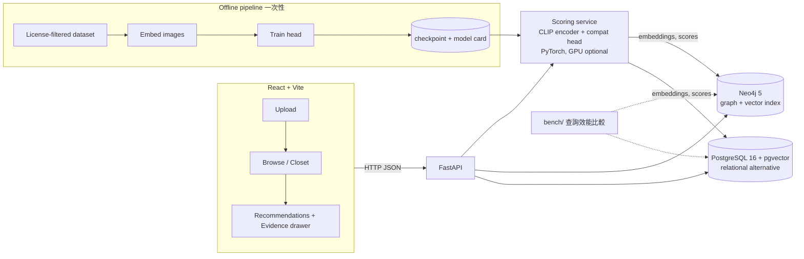

# FitReason

> DBMS + ML 的穿搭推薦系統（個人工程作品集）。把 NTU DBMS 2025 Spring 期末專案 v1（Neo4j、以 Style 標籤推薦）升級成：**用真正的 clothing compatibility 模型打分數，並且用圖資料庫查詢給出「為什麼搭」的 outfit evidence**。

狀態：**暫停（paused，2026-10-13）**，目前只有文件，尚未實作任何程式。這份計畫放在個人專案 `/home/chi/fitreason/v2/`，與研究線同一個 repo，不是另一個專案。恢復時從 `docs/04_FIRST_TASK.md`（M0）開始；詳見 [docs/00_STATUS_PAUSED.md](docs/00_STATUS_PAUSED.md)。

## 為什麼要做 V2

v1 的推薦只靠 GPT 標註的 Style 標籤（日系、韓系…），沒有任何「這兩件衣服實際上搭不搭」的模型，資料也是爬來的 QueenShop 商品圖與 Instagram 貼文（版權不適合公開展示）。V2 要補三件事：

1. **真的有 compatibility scoring**：影像 embedding + 小型 compatibility head，輸出可排序的分數。
2. **可解釋的 evidence**：Neo4j 回答「A 與 B 出現在哪些 outfit、共同鄰居是什麼、推薦路徑是什麼」。
3. **合法、可公開展示的資料**：不用爬蟲資料；公開 demo 只放自己拍的照片與逐檔確認授權的圖。

## 架構

- Neo4j 是「主」資料庫（evidence、圖遍歷、vector search）；PostgreSQL 是「對照組」，同一份資料、同一組查詢，量 latency（p50/p95）與寫法複雜度。
- ML 模型是一個 Python 套件（`ml/`），由 FastAPI 在行程內呼叫（不拆微服務），介面見 `docs/02_V2_ARCHITECTURE.md`。

## 範圍（Scope）

- 資料：license-filtered 的 outfit 資料集 + 自有照片；每張圖都記錄 `source` / `license` / `attribution`。
- Neo4j schema（Item / Category / Outfit / User…）與 evidence queries。
- Compatibility scoring（pairwise 與 fill-in-the-blank 排序）。
- FastAPI：recommend / evidence / upload / health。
- React：上傳、瀏覽、推薦結果、evidence 面板。
- PostgreSQL schema + 同題查詢效能比較報告。

## 非目標（Non-goals）

- **不**繼續做研究線（SHIFT15M temporal reliability）。研究線已結案、凍結，就在同一個專案的上層（`/home/chi/fitreason/`，報告是 `FINAL_RESEARCH_REPORT.md`）。`v2/` 不 import、不複製 `step0/` 的 data / features / 權重。
- **不**使用 SHIFT15M（沒有原始圖片，不能 demo）。
- **不**做使用者帳號系統 / 付款 / 商品爬蟲 / 即時 Instagram 抓取。
- **不**追求 SOTA accuracy；追求「可重現、授權乾淨、能 demo、能解釋」。
- **不**做 GPT 標註流程（v1 的 `loader/instagram_neo4j.py`）；Style 只作為可選的輔助標籤。

## 與研究線的關係（只繼承結論與架構）

| 研究結論 | V2 怎麼用 |
|---|---|
| Visual MLP（hidden 256、dropout 0.3、AdamW lr 3e-4 wd 1e-2、softmax-CE over 4 candidates）在跨年份下可靠度下降 | 只**重用架構與訓練配方**，在新資料上重訓；不重用任何 SHIFT15M 權重/特徵 |
| 沒有值得採用的新 reliability 方法 | 產品 `confidence` = 單模型 MSP（最大 softmax）；UI 對「使用者上傳圖」顯示 domain-shift 警語，不宣稱校準 |
| ensemble-mean-MSP 只比 MSP 好一點（AUROC +0.02）、成本 5 倍 | 預設關閉；`ensemble=true` 為可選旗標，不列入 MVP |

## 文件

- [docs/00_STATUS_PAUSED.md](docs/00_STATUS_PAUSED.md) — 暫停狀態與恢復指引
- [docs/01_RECOVERY_AND_BACKUP.md](docs/01_RECOVERY_AND_BACKUP.md) — 資料現況、備份、v1 復原
- [docs/02_V2_ARCHITECTURE.md](docs/02_V2_ARCHITECTURE.md) — 最小架構、schema、API、資料授權決策
- [docs/03_ROADMAP.md](docs/03_ROADMAP.md) — 里程碑與驗收
- [docs/04_FIRST_TASK.md](docs/04_FIRST_TASK.md) — 第一個可執行任務
